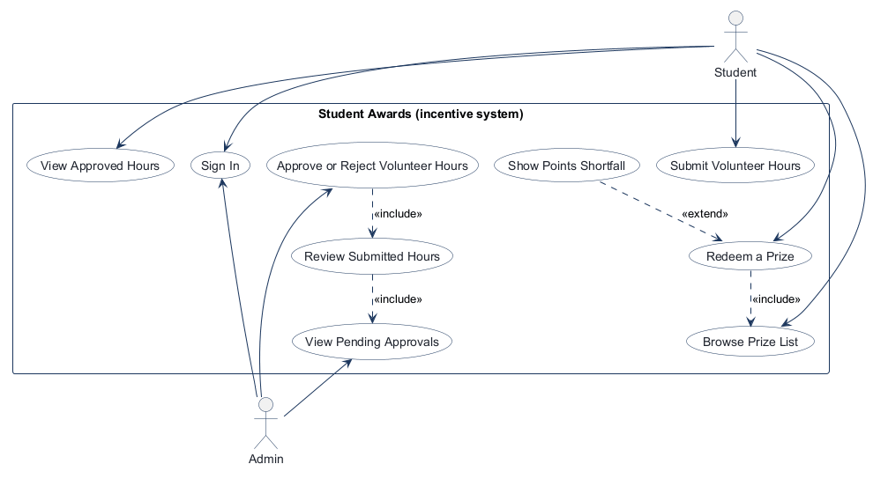
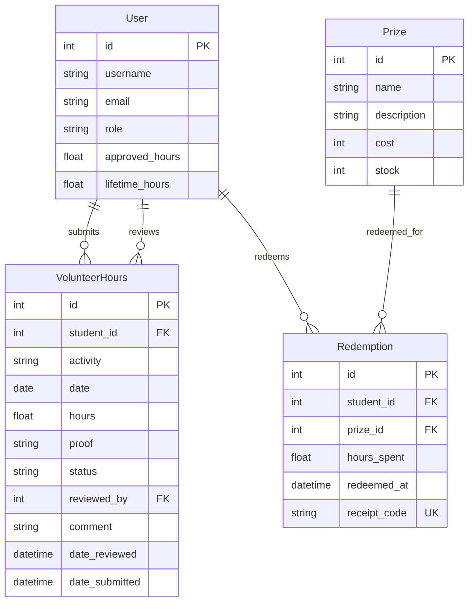
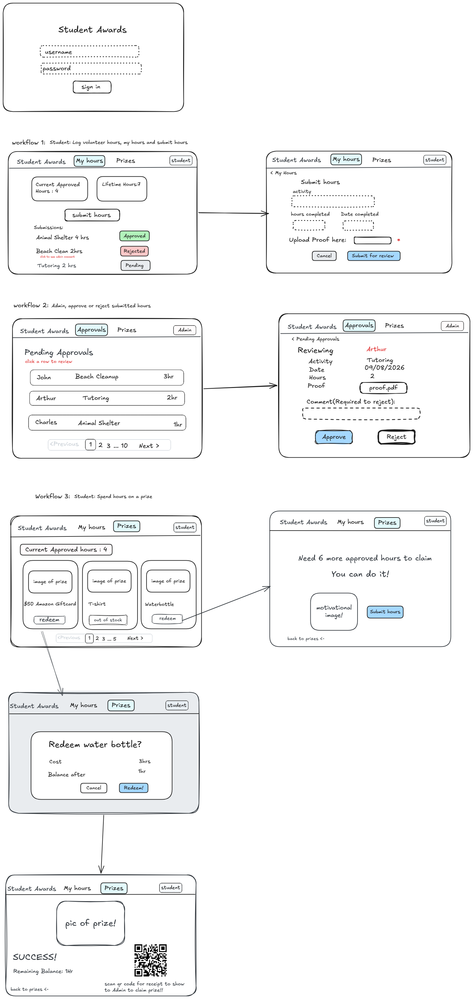

<!-- student-build:skill-integrity
status: pass
root: e84cd692d0b85eefe546385661958c27d07e8be6c5176a82012f68ccff5c8beb
expected_root: e84cd692d0b85eefe546385661958c27d07e8be6c5176a82012f68ccff5c8beb
mismatches: none
-->

# COMP 3613 Assignment 1

Draft this file with the Guide. **Update it after every phase milestone** before you pause. The use-case diagram is a UML PNG at `docs/diagrams/use-case.png`, linked from this file as `diagrams/use-case.png` (path relative to `docs/report.md`). The model diagram is Mermaid. **Embed wireframe images** as `wireframes/<file>` (files live in `docs/wireframes/`).

Do not put your student ID in this file if you will commit it. The PDF cover adds your name and ID at export time.

## Assigned project
Student Awards (incentive system)

## Three workflows

### 1.
Submit Volunteer Hours (Student)

### 2.
Approve or Reject Volunteer Hours (Admin)

### 3.
Redeem a Prize (Student)

## Use case diagram

Student and Admin both sign in; the workflows are role-specific. Approving or rejecting hours includes reviewing the submission and pending-approval list. Redeeming a prize includes browsing the list, which shows required approved points and stock. If the student has too few approved points, a conditional extension reports the shortfall. The approved-hours and pending-approvals views are separate use cases.

## Model diagram

Phase 5 model revision: added cumulative `User.lifetime_hours`, changed approved/submitted/spent hours to floats as decided, constrained volunteer-hour status to Pending/Approved/Rejected, and added a unique random receipt code to Redemption.

Assumption: `reviewed_by` points to another `User` record, typically an admin, and prize redemption is a separate record linked to the student and prize.

## Wireframes

### Student Awards workflow board

Model revision notes from the wireframe:
- `User.current_hrs` → `User.approved_hours` — seen on the student and prize screens, where the value is described as "Current approved hours" and used to gate prize redemption.
- `User.lifetime_hours` — shown separately from the current approved balance; the student chose to count approved hours only. It increases on approval and is not reduced by redemptions.
- `VolunteerHours.status` — seen on the student hours list where rows are labeled "Approved", "Rejected", and "Pending"; keep a constrained status field in the model rather than a free-form string.
- `VolunteerHours.proof` — seen on the submit form where the student uploads proof and is tied to each volunteer-hours record.
- `Prize.stock` — seen on the prize list where each prize displays stock and availability.
- `Redemption.redeemed_at` — seen on the redeemed success card and consistent with a separate prize redemption record.
- Phase 5 student revisions: `User.approved_hours`, `VolunteerHours.hours`, and `Redemption.hours_spent` use float types; `VolunteerHours.status` is a constrained Pending/Approved/Rejected enum.
- Phase 5 redemption decisions: stock decreases immediately when the student confirms; each redemption receives a unique random `receipt_code` for its QR receipt.
- Phase 5 starter catalog: Amazon Giftcard costs 10 approved hours and starts with stock 5; T-shirt costs 4 hours and starts out of stock (0); Waterbottle costs 3 hours and starts with stock 10.

<!-- student-build:wireframe-coverage
use_case: Submit Volunteer Hours (Student)
image: docs/wireframes/wireframes.png
covered: yes
-->

<!-- student-build:wireframe-coverage
use_case: Approve or Reject Volunteer Hours (Admin)
image: docs/wireframes/wireframes.png
covered: yes
-->

<!-- student-build:wireframe-coverage
use_case: Redeem a Prize (Student)
image: docs/wireframes/wireframes.png
covered: yes
-->

<!-- student-build:wireframe-coverage
use_case: Sign In
image: docs/wireframes/wireframes.png
covered: yes
-->

`python manage.py report` also embeds any PNG/JPG still missing from `docs/wireframes/`.

## Theming

- Colors: gold and navy blue, with light neutral backgrounds for readability.
- Type: gamified and playful.
- Tone: playful and encouraging.
- Logo / wordmark: Student Awards with a small star icon.
- Applied across landing, login, registration, and the authenticated shell using shared CSS tokens, Fredoka display type, Nunito body type, star branding, and encouraging copy.

## Implementation notes

One named workflow at a time. Include verify notes and polish / model revisions (Phase 5). Do not treat the first build as final.

Phase 5 theming is applied to the landing, login, registration, and authenticated shell. Submit Volunteer Hours now has a My Hours dashboard, pending-status history, approved and lifetime totals, a separate submission form, local proof-file storage, and a thin service-calling route. The student chose to return to My Hours after submit, and to count approved hours only in Lifetime Hours. Student verified locally after initializing and running the app: a newly registered account submitted 2 hours with PNG proof, returned to My Hours, saw the entry as Pending, retained an approved balance of 0, and found the file in `uploads/`.

Approve or Reject Volunteer Hours now has an admin pending list and review screen, an admin-only proof-file link, Pending-only review rules, required rejection comments, reviewer attribution, and balance updates on approval. The student chose to increment both approved and lifetime totals when approval is saved. Student verified the admin flow locally and reported that it works according to the wireframe.

Redeem a Prize is implemented with student-selected initial values: `$50 Amazon Giftcard` costs 10 hours with stock 5, `T-shirt` costs 4 hours with stock 0, and `Waterbottle` costs 3 hours with stock 10. The catalog is seeded idempotently from `init --no-drop`. Stock is decremented at confirmation; the student selected the service to coordinate eligibility and a unique random receipt code for the QR receipt. The app now includes the catalog, shortfall, confirmation, and success/QR receipt views. Student ran `init --no-drop` and `run`, then verified the workflow and reported that everything works as intended.

Polish revision: the student chose the wireframe’s Giftcard → T-shirt → Waterbottle catalog order; the repository now sorts by descending cost to match that presentation. The student refreshed the Prizes page and confirmed the new order matches the wireframe.

<!-- student-build:code-check
workflow: Submit Volunteer Hours (Student)
form: choice
layer: other
architecture_ok: yes
implement_confidence: 0.75
passed: yes
note: Chose to return to My Hours with the new item marked Pending, matching the wireframe lifecycle.
-->

<!-- student-build:code-check
workflow: Submit Volunteer Hours (Student)
form: snippet
layer: model
architecture_ok: yes
implement_confidence: 0.60
passed: partial
note: Added the approved-hours balance and submission model; several property names diverged from the ERD and needed alignment.
-->

<!-- student-build:code-check
workflow: Submit Volunteer Hours (Student)
form: choice
layer: model
architecture_ok: yes
implement_confidence: 0.60
passed: yes
note: Chose to retain the agreed ERD field names and revise the model snippet to match.
-->

<!-- student-build:code-check
workflow: Submit Volunteer Hours (Student)
form: choice
layer: model
architecture_ok: yes
implement_confidence: 0.60
passed: yes
note: Revised the ERD hours property from decimal to float at the student's request.
-->

<!-- student-build:code-check
workflow: Submit Volunteer Hours (Student)
form: choice
layer: model
architecture_ok: yes
implement_confidence: 0.60
passed: yes
note: Student requested float types for User.approved_hours and Redemption.hours_spent; both were updated in the ERD.
-->

<!-- student-build:code-check
workflow: Submit Volunteer Hours (Student)
form: snippet
layer: model
architecture_ok: yes
implement_confidence: 0.50
passed: partial
note: Second model attempt retained ERD mismatches for reviewer/comment fields and included unresolved Enum/date typing issues; a corrected pass is required.
-->

<!-- student-build:code-check
workflow: Submit Volunteer Hours (Student)
form: snippet
layer: model
architecture_ok: yes
implement_confidence: 0.60
passed: yes
note: Corrected VolunteerHours fields/types to match the revised ERD, including the constrained status enum.
-->

<!-- student-build:code-check
workflow: Submit Volunteer Hours (Student)
form: snippet
layer: repository
architecture_ok: yes
implement_confidence: 0.60
passed: yes
note: Repository adds, commits, refreshes, and returns the VolunteerHours record; no business rules in the repository.
-->

<!-- student-build:code-check
workflow: Submit Volunteer Hours (Student)
form: choice
layer: service
architecture_ok: yes
implement_confidence: 0.60
passed: yes
note: Chose local upload storage with its path recorded in VolunteerHours.proof.
-->

<!-- student-build:code-check
workflow: Submit Volunteer Hours (Student)
form: snippet
layer: service
architecture_ok: yes
implement_confidence: 0.60
passed: yes
note: Service validates inputs, writes proof locally, creates Pending record, and delegates persistence.
-->

<!-- student-build:code-check
workflow: Submit Volunteer Hours (Student)
form: snippet
layer: router
architecture_ok: yes
implement_confidence: 0.40
passed: partial
note: Thin service-calling route attempt used the wrong repository constructor keyword, omitted the success redirect, and passed an optional user id without a guard.
-->

<!-- student-build:code-check
workflow: Submit Volunteer Hours (Student)
form: snippet
layer: router
architecture_ok: yes
implement_confidence: 0.60
passed: yes
note: Corrected route guards user.id, calls the service without persistence logic, explicitly handles expected errors, and redirects on success.
-->

<!-- student-build:code-check
workflow: Submit Volunteer Hours (Student)
form: open
layer: other
architecture_ok: yes
implement_confidence: 0.60
passed: yes
note: Student confirmed end-to-end local submission, Pending display, unchanged approved balance, and local PNG proof storage.
-->

<!-- student-build:code-check
workflow: Approve or Reject Volunteer Hours (Admin)
form: choice
layer: service
architecture_ok: yes
implement_confidence: 0.60
passed: yes
note: Chose to increment approved_hours and lifetime_hours when an admin approval is saved.
-->

<!-- student-build:code-check
workflow: Approve or Reject Volunteer Hours (Admin)
form: snippet
layer: model
architecture_ok: yes
implement_confidence: 0.50
passed: partial
note: Added User-side submitted/reviewed relationships; VolunteerHours relationship declarations were outside the model class and need correction.
-->

<!-- student-build:code-check
workflow: Approve or Reject Volunteer Hours (Admin)
form: snippet
layer: model
architecture_ok: yes
implement_confidence: 0.50
passed: yes
note: Added paired SQLModel relationships for student submissions and admin reviews using their distinct foreign keys.
-->

<!-- student-build:code-check
workflow: Approve or Reject Volunteer Hours (Admin)
form: snippet
layer: repository
architecture_ok: yes
implement_confidence: 0.50
passed: yes
note: Pending list query uses the HoursStatus enum and oldest-first ordering; the submission workflow has made the student's enum choice concrete.
-->

<!-- student-build:code-check
workflow: Approve or Reject Volunteer Hours (Admin)
form: snippet
layer: service
architecture_ok: yes
implement_confidence: 0.40
passed: partial
note: Initial review service updates status and approved/lifetime totals, but omits the pending-only guard, required rejection comment, and reviewer foreign key assignment.
-->

<!-- student-build:code-check
workflow: Approve or Reject Volunteer Hours (Admin)
form: snippet
layer: service
architecture_ok: yes
implement_confidence: 0.40
passed: yes
note: Revised service enforces Pending-only review, requires rejection comment, records reviewer, and updates both approved/lifetime balances on approval.
-->

<!-- student-build:code-check
workflow: Approve or Reject Volunteer Hours (Admin)
form: snippet
layer: router
architecture_ok: yes
implement_confidence: 0.40
passed: yes
note: Thin admin route validates the decision, delegates review to the service, passes admin ID/comment, renders validation errors, and redirects on success.
-->

<!-- student-build:code-check
workflow: Approve or Reject Volunteer Hours (Admin)
form: open
layer: other
architecture_ok: yes
implement_confidence: 0.60
passed: yes
note: Student verified locally and confirmed the approval flow matches the wireframe.
-->

<!-- student-build:code-check
workflow: Redeem a Prize (Student)
form: choice
layer: service
architecture_ok: yes
implement_confidence: 0.60
passed: yes
note: Chose to decrease prize stock when the student confirms redemption.
-->

<!-- student-build:code-check
workflow: Redeem a Prize (Student)
form: mcq
layer: service
architecture_ok: yes
implement_confidence: 0.60
passed: yes
note: Identified the service as the layer to coordinate balance and stock eligibility decisions.
-->

<!-- student-build:code-check
workflow: Redeem a Prize (Student)
form: choice
layer: model
architecture_ok: yes
implement_confidence: 0.60
passed: yes
note: Chose a unique random receipt code for the QR receipt rather than exposing the redemption record ID.
-->

<!-- student-build:code-check
workflow: Redeem a Prize (Student)
form: snippet
layer: model
architecture_ok: yes
implement_confidence: 0.60
passed: yes
note: Added Prize fields and Redemption foreign keys, float hours, timestamp, and a unique random receipt code.
-->

<!-- student-build:code-check
workflow: Redeem a Prize (Student)
form: snippet
layer: repository
architecture_ok: yes
implement_confidence: 0.50
passed: yes
note: Repository returns the catalog ordered by prize cost; the student corrected the initial name sort.
-->

<!-- student-build:code-check
workflow: Redeem a Prize (Student)
form: snippet
layer: service
architecture_ok: yes
implement_confidence: 0.50
passed: yes
note: Service checks missing records, stock and approved balance, then deducts the cost, decrements stock, and creates a redemption without changing lifetime hours.
-->

<!-- student-build:code-check
workflow: Redeem a Prize (Student)
form: snippet
layer: router
architecture_ok: yes
implement_confidence: 0.40
passed: partial
note: Route calls the service and redirects correctly; Guide corrected the mismatched flash helper keyword after repeated unchanged attempts.
-->

<!-- student-build:code-check
workflow: Redeem a Prize (Student)
form: choice
layer: repository
architecture_ok: yes
implement_confidence: 0.60
passed: yes
note: Chose the wireframe catalog order over ascending cost; query now sorts descending cost to show Giftcard, T-shirt, Waterbottle.
-->

<!-- student-build:code-check
workflow: Submit Volunteer Hours (Student)
form: choice
layer: model
architecture_ok: yes
implement_confidence: 0.60
passed: yes
note: Chose approved hours only for the Lifetime Hours display; added a separate cumulative float field in the ERD and User model.
-->

## Deployed app

Phase 6. Public Render URL (not localhost). Markers open this to mark the three workflows.

https://faststarter-tm32.onrender.com/

## GitHub repository

https://github.com/aliyahrr/comp3613a1

## Logins

Every account a marker needs, including extra users you added. Starter accounts:

- bob / bobpass — regular user
- admin / adminpass — admin

## YouTube URL

https://youtu.be/rchJxE5ir9g

<!-- student-judge:competency -->
<!-- student-judge:competency -->
## Competency (student-judge)

Filled by Guide from the student-judge run when this report was built.

**Judged at:** 2026-10-13T00:00:00-04:00
**Evidence pass:** re-read current docs/report.md, docs/transcripts/INDEX.md, the recovered transcript files, and the project artefacts; prior judge.md ignored

**Student / session:** Aliyah Ruan / COMP 3613A1 project
**Artifact:** Guide-written transcript bundle in `docs/transcripts/*.md` and current project report/artefacts
**Phases in evidence:** 1–6 (COMP 3613; Phase 5 polish, Phase 6 deploy; never generic 0–5)

### Totals
| | Count / value |
|--|--|
| Metrics on rubric | 12 (M1–M12) |
| N/A (excluded) | 0 |
| Metrics scored | 12 |
| Scoreable max | 48 |
| Awarded total | 46 / 48 |
| **Overall (avg of scored)** | **3.8 / 4** |
| Impression mark | 19 / 20 |

## Scorecard

| ID | Metric | Score / 4 | In avg | Evidence |
|----|--------|----------:|:------:|----------|
| M1 | Phase discipline | 4 | yes | The project clearly moved through design, use-case drafting, wireframe refinement, implementation, verification, and final deployment. The transcript set preserves the phase flow and the final report is updated after each major milestone. |
| M2 | Problem framing | 4 | yes | The report and transcripts consistently name the project and the three workflows: Submit Volunteer Hours, Approve or Reject Volunteer Hours, and Redeem a Prize. The student also clarified balance logic and insufficient-hours behavior. |
| M3 | Decision ownership | 4 | yes | The student set the project concept and own decisions for the award model, approved-hours balance, lifetime-hours tracking, catalog values, stock, and the final UI/workflow revisions. |
| M4 | Artefact-before-code | 4 | yes | The report and transcript bundle show use-case and wireframe work before implementation, and the app implementation follows those specs. The project consistently uses the ERD and wireframe as the source of truth. |
| M5 | Verification habit | 4 | yes | The transcript/report record local verification for submission, admin approval, and redemption flows. The student also checked catalog order and reported the actual observed behavior. |
| M6 | Assignment fit | 4 | yes | The implementation follows the FastStarter architecture and the project’s layered expectations: routes call business logic rather than performing inline persistence. The report also discusses theme/build/polish before deployment. |
| M7 | Slice explanation | 4 | yes | The project explains the workflow-specific model decisions and the service/repository layering. The report contains the architecture-aware code-check notes and the final model choices are justified in the project report. |
| M8 | Prompt quality | 4 | yes | The chats are well phase-tagged and precisely targeted: use-case draft, wireframe update, implementation, verification, and final deployment follow-up. |
| M9 | Response to pushback | 4 | yes | The work demonstrates iterative refinement after mismatches, especially around the wireframe alignment, catalog order, and final project polish/verification. |
| M10 | Integrity | 4 | yes | The skill-integrity marker is present and passing; no suspicious external-assist or paste-back behavior is supported by the current transcript set. |
| M11 | Provenance continuity | 4 | yes | The final report, transcript set, and implementation all track the same Student Awards scope and same named workflows from phase 1 through deployment. |
| M12 | Sincerity trajectory | 4 | yes | No suspicion spiral or low-confidence pattern appears in the current evidence; project progression is coherent and consistent across the transcript sequence. |

## Strengths
- The project shows clear phase discipline from design through deployment, with the transcript bundle covering the major guided turns.
- The student’s decisions are well-owned: the role split, approved-hours balance, lifetime-hours tracking, prize stock, and catalog ordering all align with the intended app logic.
- The wireframe and ERD are used as the implementation spec, and the app was verified through actual workflow observations rather than a single acceptance dump.
- Phase 5 polish is visible in the themed UI, verification comments, and model refinements, and the final deployment URL is included in the report.
- The transcript recovery work is now reflected in the packaged transcript set, so the evidence package is consistent with the project chronology.

## Gaps (priority order)
1. None after this fresh evidence pass. The project records a complete phase progression and a coherent final deployment state.

## Phase gate status
| Phase | Status | Note |
|-------|--------|------|
| 1 | met | The project concept and the three named workflows are clearly established in the report and transcript set. |
| 2 | met | Use-case framing and the role split are clearly established; the student engaged the required workflow and balance logic. |
| 3 | met | The entity and property decisions are reflected in the model and final report. |
| 4 | met | The wireframe is present and used to anchor the implementation choices and verification checks. |
| 5 | met | Theme, implementation, per-workflow verification, and polish are all documented. |
| 6 | met | Deployment URL and presentation URL are included in the final report state. |

## Recommended next practice
- Keep the current project pattern: continue with concrete, workflow-led prompts and per-feature verification before any further polish or deployment adjustment.

## Integrity note
- Clean
## Provenance flags
- None
## Sincerity log summary
- Blocks found: 0 | max round: 0 | min/mean/final confidence: n/a | trend: n/a | cleared: n/a
## Skips
- Skips: 0/3 used

## Skill integrity

Course skills are hashed at export and compared to `.agents/skills.lock.json`. Do not edit `.agents/skills/`, `.cursor/skills/`, or `AGENTS.md`.

- Status: **pass**
- Root: `e84cd692d0b85eefe546385661958c27d07e8be6c5176a82012f68ccff5c8beb`
- none
