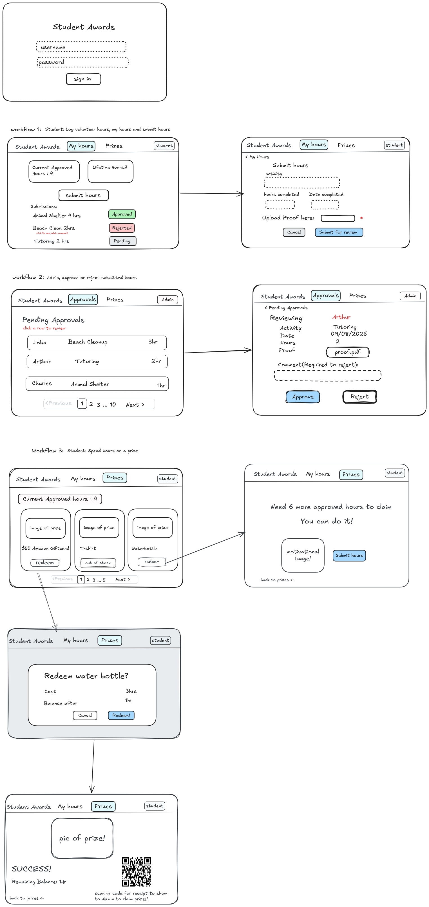

# Student Awards Test Planning

## User Acceptance Test Plan

The UAT scenarios below follow the screens and transitions in the Student Awards
wireframe. Run them in the application and record observed results; do not mark a
test as passed based on the Postman collection alone.



### Test setup

- The supplied run used `bob` as the student and `admin` for review.
- Before the captured submission, Bob's dashboard showed 2 approved hours and 12 lifetime hours.
- The student submitted 4 hours; after admin approval, the dashboard showed 6 approved hours and 16 lifetime hours.
- The prize shop showed the $50 Amazon Giftcard at 10 hours, the T-shirt out of stock, and the Waterbottle at 3 hours.

### UAT cases

“Pass (recorded)” means the outcome was reported from the supplied manual
execution evidence.

| ID | Preconditions and test action | Acceptance criteria | Actual result, evidence, and status |
|---|---|---|---|
| UAT-01 | Sign in as student `bob`. | Student session opens with My Hours and Prizes navigation. | Student navigation was visible in supplied screenshots. Pass (recorded). |
| UAT-02 | As `bob`, submit 4 hours for Animal Shelter with date and proof. | Submission is Pending; balance remains 2.0 before review. | Pending status and unchanged 2.0 balance were shown. Pass (recorded). |
| UAT-03 | As `admin`, approve Bob's pending 4-hour Animal Shelter submission. | Status becomes Approved; approved/lifetime totals increase by 4.0. | Approved; balances changed 2.0 → 6.0 and 12.0 → 16.0. Pass (recorded). |
| UAT-04 | As `admin`, reject a pending submission with comment blank. | Rejection is blocked and required-comment validation appears. | “A comment is required when rejecting a submission.” Pass (recorded). |
| UAT-05 | As `admin`, reject Bob's 2-hour Planting trees submission with “proof is blurry”. | Rejection completes with the supplied comment. | Admin entered the comment and completed rejection. Pass (recorded). |
| UAT-06 | As `bob` with 6.0 approved hours, view the T-shirt in Prizes. | Balance is 6.0 and T-shirt availability is shown as out of stock. | 6.0 balance and “Out of stock” label were shown. Pass (recorded). |
| UAT-07 | As `bob`, view the $50 giftcard costing 10 hours. | Shortfall of 4.0 hours is stated; submit-hours and return options are available. | Screen stated 4.0 more hours were needed and showed both options. Pass (recorded). |
| UAT-08 | As `bob`, select the 3-hour Waterbottle and cancel confirmation. | Cancellation returns to Prizes without redeeming. | Confirmation showed 3-hour cost / projected balance; cancel returned to shop without redemption. Pass (recorded). |
| UAT-09 | As `bob`, confirm the Waterbottle redemption. | Success shows 3.0 remaining hours and receipt/QR. | Success screen showed 3.0 balance, QR, and receipt code. Pass (recorded). |

## Unit Test Plan

Unit tests isolate service behaviour using a test database and controlled
student, admin, and prize records.

| ID | Test case | Expected result |
|---|---|---|
| UT-01 | Submit volunteer hours with a value of zero. | `VolunteerHoursService` raises a validation error stating hours must be more than zero. |
| UT-02 | Approve a pending 3.5-hour submission. | The submission becomes Approved, and the student's approved and lifetime totals each increase by 3.5 hours. |
| UT-03 | Redeem a 4-hour prize with 10 approved hours and stock of 2. | A redemption records 4 hours spent, the student's balance becomes 6 hours, and prize stock becomes 1. |

## Integration Test Plan

FastAPI `TestClient` tests exercise complete HTTP requests against an isolated
test database, including authentication, request validation, route responses,
and persisted state.

| ID | Test case | Expected result |
|---|---|---|
| IT-01 | Submit volunteer hours through the browser form with a proof upload. | The route redirects with status 303 and stores one Pending submission for the student. |
| IT-02 | Create a volunteer-hours resource through `POST /api/hours` with form fields and a proof upload. | The route returns 201 with the public resource fields and does not expose the stored proof path. |
| IT-03 | Submit zero hours through the browser form. | Request validation returns 422 and no valid submission is created. |
| IT-04 | Approve a student's pending submission as an admin. | The route redirects with status 303, the submission becomes Approved, and the student's approved balance increases. |
| IT-05 | Redeem a prize as an authenticated student with sufficient hours. | The route redirects with status 303 and prize stock decreases by one. |
| IT-06 | Request the admin page without an authenticated session. | The route returns 401 Unauthorized. |
| IT-07 | Request the admin page as an authenticated student. | The route returns 403 Forbidden. |

## Test execution

Run the unit and integration test plans from the repository root with:

```powershell
.\.venv\Scripts\python.exe -m pytest tests\test_services.py tests\test_routes.py -q
```
