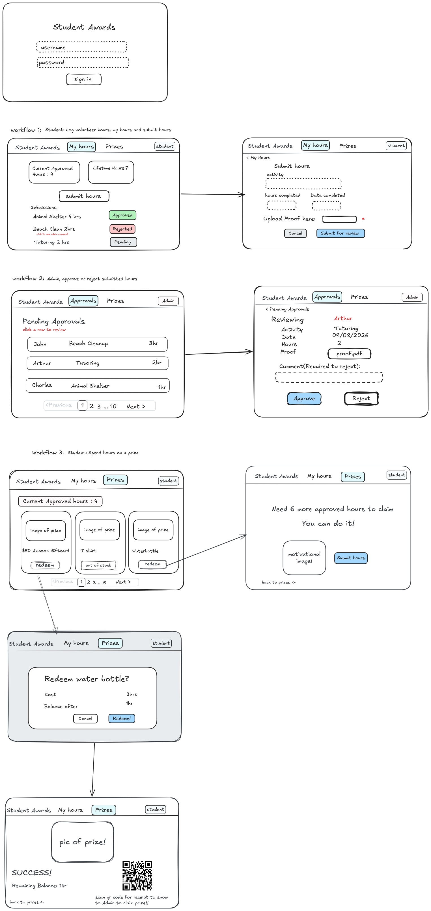
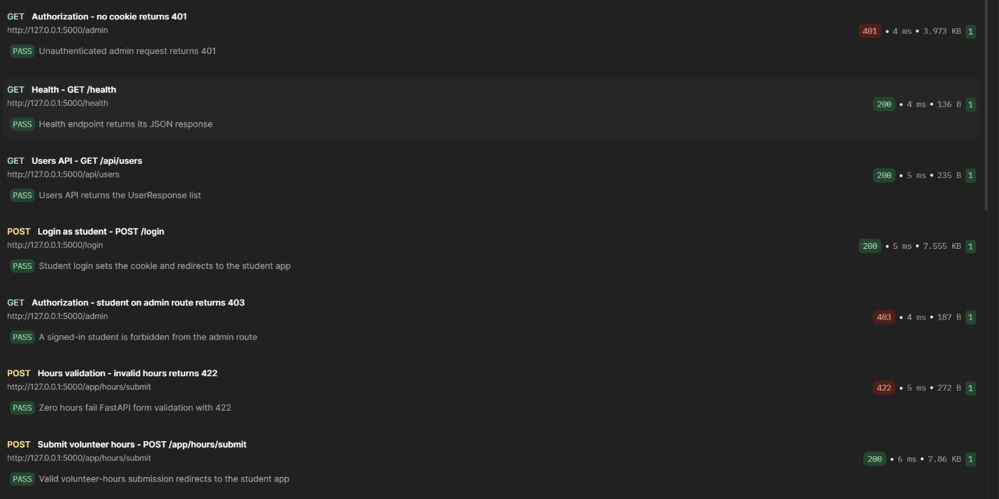
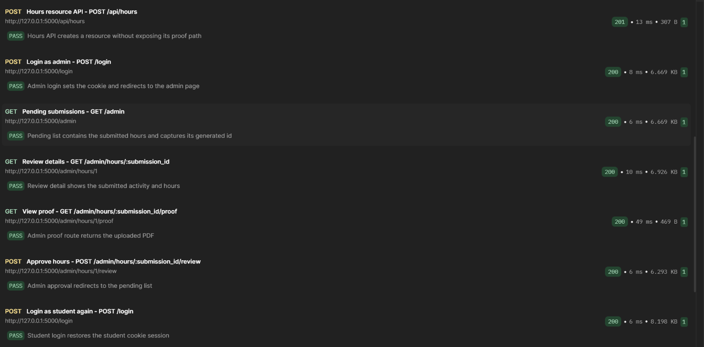
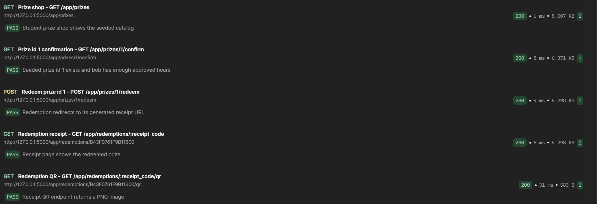

# Student Awards Testing Submission

## Project Description

Student Awards is a FastAPI incentive application for tracking student volunteer
hours and exchanging approved hours for prizes. Students submit volunteer
activities with proof for admin review. Approved submissions increase the
student's spendable approved-hours balance and cumulative lifetime-hours total.
Students can browse prizes, see stock and point requirements, and redeem an
eligible prize with a receipt and QR code. Admins can approve or reject pending
submissions; a rejection requires a comment.

## Use Case Diagram


The Student actor signs in, submits hours, views approved hours, browses prizes,
and redeems prizes. The Admin actor signs in, views pending approvals, and
reviews submissions for approval or rejection. Prize redemption includes
browsing the prize list; a points-shortfall message is a conditional extension.

## Entity Relationship Diagram


`reviewed_by` refers to the admin User who reviewed the submission. A
Redemption links a student to a prize and stores the hours spent and unique
receipt code.

## Application Wireframe



## Test Plans

The test plans and UAT cases follow the wireframe workflows:

1. Submit volunteer hours as a student.
2. Approve or reject a submission as an admin.
3. Browse prizes and redeem one as a student.

### User Acceptance Test Record

The cases below record the reported manual execution against the application
wireframe. “Pass (recorded)” reflects the supplied observations.

**Test setup:** Student account `bob`; administrator account `admin`. Before
the captured approval, Bob had 2.0 approved hours and 12.0 lifetime hours.
The prize-shop scenarios used a 6.0-hour approved balance. The catalog showed
the T-shirt out of stock, the $50 giftcard at 10 hours, and the Waterbottle
at 3 hours.

| ID | Preconditions and test action | Acceptance criteria | Actual result, evidence, and status |
|---|---|---|---|
| UAT-01 | Sign in as student `bob`. | Student session opens with My Hours and Prizes navigation. | Student navigation was visible in supplied screenshots. Pass (recorded). |
| UAT-02 | As `bob`, submit 4 hours for Animal Shelter with date and proof. | Submission is Pending; balance remains 2.0 before review. | Pending status and unchanged 2.0 balance were shown. Pass (recorded). |
| UAT-03 | As `admin`, approve Bob's pending 4-hour Animal Shelter submission. | Status becomes Approved; approved/lifetime totals increase by 4.0. | Approved; balances changed 2.0 → 6.0 and 12.0 → 16.0. Pass (recorded). |
| UAT-04 | As `admin`, reject a pending submission with comment blank. | Rejection is blocked and required-comment validation appears. | “A comment is required when rejecting a submission.” Pass (recorded). |
| UAT-05 | As `admin`, reject Bob's 2-hour Planting trees submission with “proof is blurry”. | Rejection completes with the supplied comment. | Admin entered the comment and completed rejection. Pass (recorded). |
| UAT-06 | As `bob` with 6.0 approved hours, view the T-shirt in Prizes. | Balance is 6.0 and T-shirt availability is shown as out of stock. | 6.0 balance and “Out of stock” label were shown. Pass (recorded). |
| UAT-07 | As `bob`, view the $50 giftcard costing 10 hours. | Shortfall of 4.0 hours is stated; submit-hours and return options are available. | Screen stated 4.0 more hours were needed and showed both options. Pass (recorded). |
| UAT-08 | As `bob`, select the 3-hour Waterbottle and cancel confirmation. | Cancellation returns to Prizes without redeeming. | Confirmation showed 3-hour cost / projected balance; cancel returned to shop without redemption. Pass (recorded). |
| UAT-09 | As `bob`, confirm the Waterbottle redemption. | Success shows 3.0 remaining hours and receipt/QR. | Success screen showed 3.0 balance, QR, and receipt code. Pass (recorded). |

Detailed UAT tasks, criteria, and observations: [User Acceptance Test Plan](test-plans.md#user-acceptance-test-plan).

### Unit Test Plan

Service-level tests verify that invalid hours are rejected, approving a
submission updates approved and lifetime totals, and prize redemption deducts
the cost and decrements prize stock. The tests use isolated test data.

### Integration Test Plan

FastAPI TestClient route tests exercise multipart volunteer-hour submission,
the `POST /api/hours` resource response, 422 validation for zero hours, admin
review, prize redemption, and authorization responses (401 without a session
and 403 for a student accessing an admin route).

Detailed test plans: [Test Plans](test-plans.md#unit-test-plan).

Reference documents supplied for this assignment:

- [COMP 3613 Test Plans](https://docs.google.com/document/d/1YQPB1vPS0SFb6tIUAxmxrSUIsj-d6u98USWzvMi4mJs/edit#heading=h.yf77zv73ijjj)
- [User Acceptance Test Plan reference](https://docs.google.com/document/d/1LIPdWA39zJCuzTgSkwTKjnaqi8Yn9STFZckn4MBsf48/edit?usp=sharing)

## Unit Tests

Test file: [tests/test_services.py](../tests/test_services.py)

Command:

```powershell
.\.venv\Scripts\python.exe -m pytest tests\test_services.py -q
```

Result: **3 passed, 1 non-failing deprecation warning.**

## Integration Tests

Test file: [tests/test_routes.py](../tests/test_routes.py)

Command:

```powershell
.\.venv\Scripts\python.exe -m pytest tests\test_routes.py -q
```

Result: **7 passed, 1 non-failing deprecation warning.**

## API Tests (Postman)

The exported collection is [student-awards-api.postman_collection.json](postman/student-awards-api.postman_collection.json).
It exercises the actual FastAPI routes and cookie-based authentication,
including invalid-hours validation, authorization, both form and JSON resource submissions, review,
redemption, receipt, and QR responses. The latest Newman run completed with
**19 assertions passed and 0 failed** against the freshly seeded disposable
database at `http://127.0.0.1:8000`.

## Implementation

The application uses FastAPI and SQLModel with a layered structure:
**routes → services → repositories → models**. Routes bind form/API input and
delegate business operations to services; repositories handle persistence.
Student routes provide hours history, proof upload, prize browsing, shortfall
guidance, prize confirmation, redemption, and QR receipts. Admin routes provide
a pending-approval list and submission review. The review service enforces
Pending-only decisions and requires a comment to reject. Prize redemption
checks stock and approved balance before updating the balance and stock.

## Repository

[https://github.com/aliyahrr/comp3613a1](https://github.com/aliyahrr/comp3613a1)

## Test Reports

### Unit Test Report


### Integration Test Report


### Postman Collection Run Report







The Newman report shows 19 requests, 19 test scripts, and 19 assertions with
zero failures. The screenshots are arranged in collection order and show
requests sent to `http://127.0.0.1:5000`, including the `POST /api/hours`
resource endpoint.
