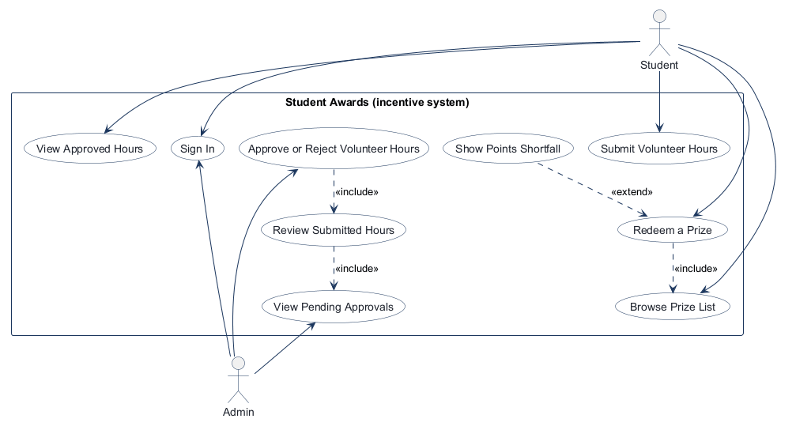
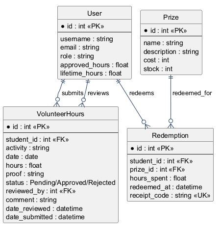
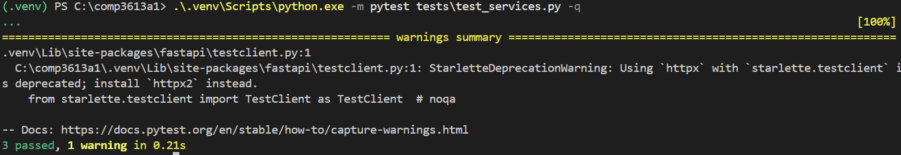
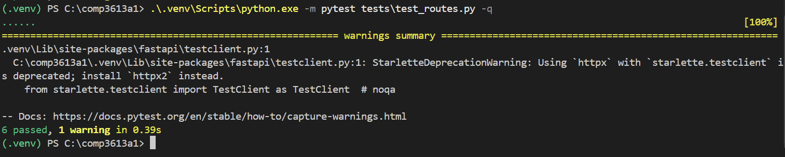
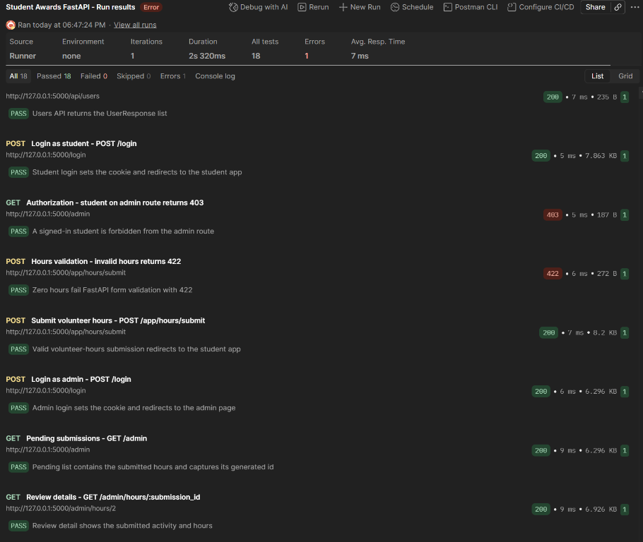

# Student Awards Testing Submission

## Project Description

Student Awards is a FastAPI incentive application for tracking student volunteer
hours and exchanging approved hours for prizes. Students submit volunteer
activities with proof for admin review. Approved submissions increase the
student's spendable approved-hours balance and cumulative lifetime-hours total.
Students can browse prizes, see stock and point requirements, and redeem an
eligible prize with a receipt and QR code. Admins can approve or reject pending
submissions; a rejection requires a comment.

## Use Case Diagram



The Student actor signs in, submits hours, views approved hours, browses prizes,
and redeems prizes. The Admin actor signs in, views pending approvals, and
reviews submissions for approval or rejection. Prize redemption includes
browsing the prize list; a points-shortfall message is a conditional extension.

## Entity Relationship Diagram



`reviewed_by` refers to the admin User who reviewed the submission. A
Redemption links a student to a prize and stores the hours spent and unique
receipt code.

## Application Wireframe


## Test Plans

The test plans and UAT cases follow the wireframe workflows:

1. Submit volunteer hours as a student.
2. Approve or reject a submission as an admin.
3. Browse prizes and redeem one as a student.

### User Acceptance Test Plan

The manual UAT plan includes sign-in, a submission with proof, admin approval,
rejection both with and without a comment, the out-of-stock T-shirt, the
insufficient-hours message, canceling a redemption, and completing a redemption
with a QR receipt. Results recorded from the performed scenarios are:

| UAT area | Observed result | Outcome |
|---|---|---|
| Submit and approve hours | A 4-hour Animal Shelter submission appeared as Pending, then Approved. Bob's approved balance changed from 2.0 to 6.0 and lifetime hours from 12.0 to 16.0. | Pass |
| Reject without comment | The review screen displayed “A comment is required when rejecting a submission.” | Pass |
| Reject with a comment | Admin entered “proof is blurry” for Bob's 2-hour Planting trees submission and completed the rejection flow. | Pass |
| Prize availability and shortfall | With 6.0 approved hours, the T-shirt showed Out of stock; the $50 giftcard screen showed 4.0 more hours needed. | Pass |
| Cancel redemption | The Waterbottle confirmation showed cost 3 hours and a 3.0-hour balance after redemption; cancel returned to the prize shop without redeeming. | Pass |
| Redeem and receive receipt | The Waterbottle success screen showed a 3.0-hour remaining balance and QR receipt with a receipt code. | Pass |

Detailed UAT tasks, criteria, and observations: [User Acceptance Test Plan](test-plans.md#user-acceptance-test-plan).

### Unit Test Plan

Service-level tests verify that invalid hours are rejected, approving a
submission updates approved and lifetime totals, and prize redemption deducts
the cost and decrements prize stock. The tests use isolated test data.

### Integration Test Plan

FastAPI TestClient route tests exercise multipart volunteer-hour submission,
422 validation for zero hours, admin review, prize redemption, and authorization
responses (401 without a session and 403 for a student accessing an admin route).

Detailed test plans: [Test Plans](test-plans.md#unit-test-plan).

Reference documents supplied for this assignment:

- [COMP 3613 Test Plans](https://docs.google.com/document/d/1YQPB1vPS0SFb6tIUAxmxrSUIsj-d6u98USWzvMi4mJs/edit#heading=h.yf77zv73ijjj)
- [User Acceptance Test Plan reference](https://docs.google.com/document/d/1LIPdWA39zJCuzTgSkwTKjnaqi8Yn9STFZckn4MBsf48/edit?usp=sharing)

## Unit Tests

Test file: [tests/test_services.py](../tests/test_services.py)

Command:

```powershell
.\.venv\Scripts\python.exe -m pytest tests\test_services.py -q
```

Result: **3 passed, 1 non-failing deprecation warning.**

## Integration Tests

Test file: [tests/test_routes.py](../tests/test_routes.py)

Command:

```powershell
.\.venv\Scripts\python.exe -m pytest tests\test_routes.py -q
```

Result: **6 passed, 1 non-failing deprecation warning.**

## API Tests (Postman)

The exported collection is [student-awards-api.postman_collection.json](postman/student-awards-api.postman_collection.json).
It exercises the actual FastAPI routes and cookie-based authentication,
including invalid-hours validation, authorization, submission, review,
redemption, receipt, and QR responses. The recorded collection run completed
with **18 test scripts passed and 0 failed**.

## Implementation

The application uses FastAPI and SQLModel with a layered structure:
**routes → services → repositories → models**. Routes bind form/API input and
delegate business operations to services; repositories handle persistence.
Student routes provide hours history, proof upload, prize browsing, shortfall
guidance, prize confirmation, redemption, and QR receipts. Admin routes provide
a pending-approval list and submission review. The review service enforces
Pending-only decisions and requires a comment to reject. Prize redemption
checks stock and approved balance before updating the balance and stock.

## Repository

[https://github.com/aliyahrr/comp3613a1](https://github.com/aliyahrr/comp3613a1)

## Test Reports

### Unit Test Report



### Integration Test Report



### Postman Collection Run Report



The Postman screenshot shows all 18 test scripts passing with no failed
scripts. Its runner header also displays one error counter; the collection's
expected unauthorized (401) check is asserted as a passing test, and the
separate Newman summary recorded 18 assertions with zero failures.
